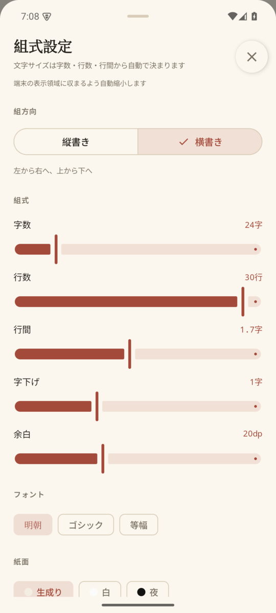
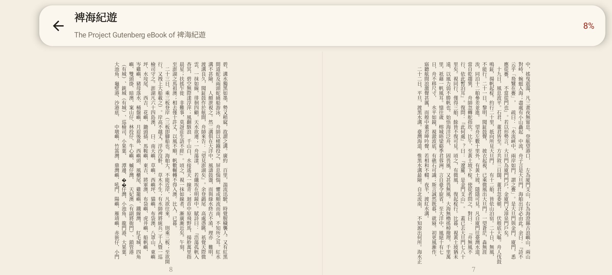
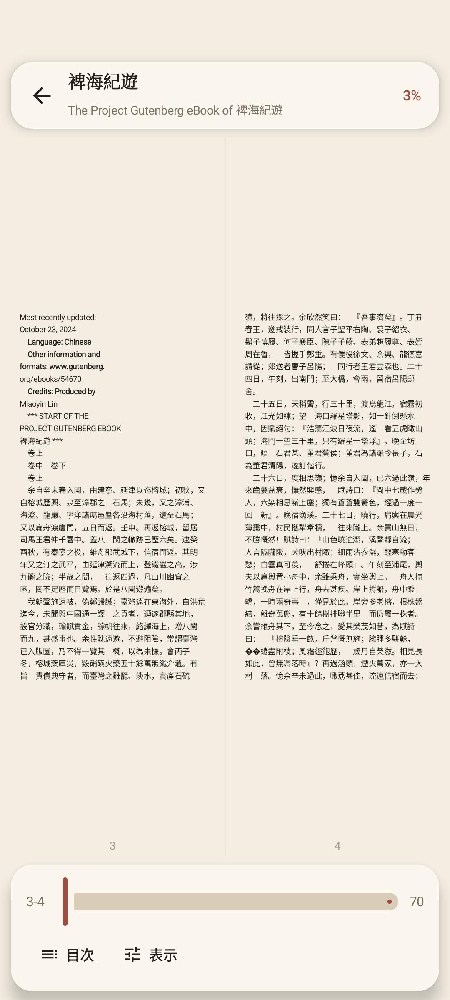
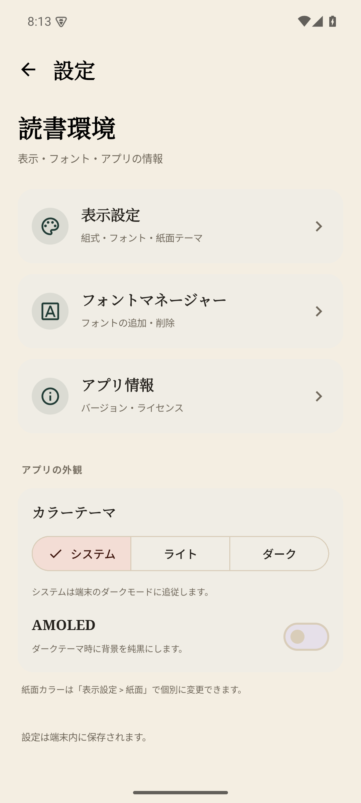
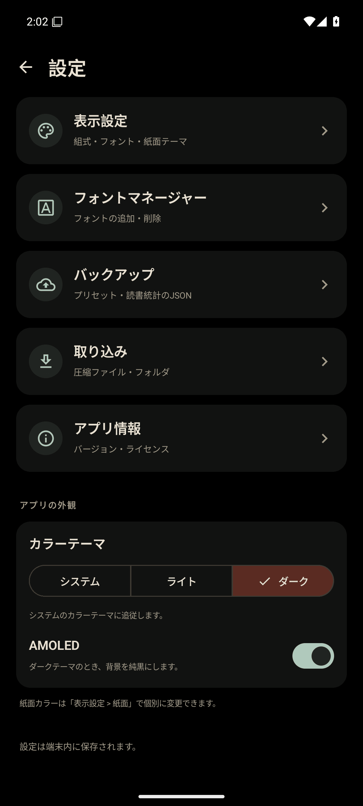
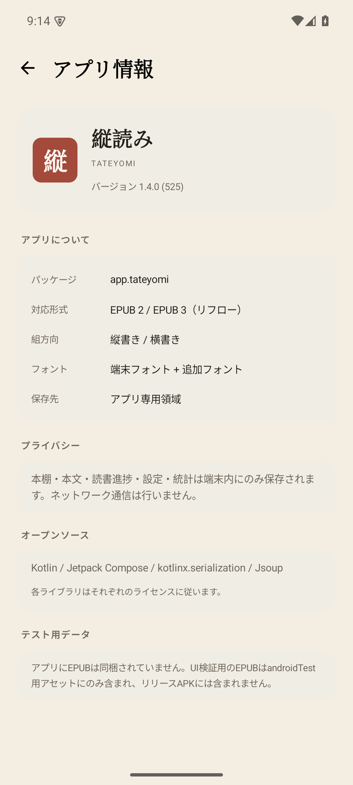

# 縦読み — Tateyomi

縦書きの組式で読むための Android 向けリーダーです。EPUB / XHTML /
CBZ / CBR / Kindle（MOBI・AZW3）に対応します。
WebView や既存の EPUB ビューアを使わず、Compose Canvas 上に日本語縦組の
レンダラーを実装しています。

| 本棚 | 縦書き（明朝・生成り） |
|---|---|
|  |  |

| 横書き（24字・行間1.7） | 縦書き（夜・明朝） |
|---|---|
|  |  |

| 目次（節アンカー対応） | リーダーの表示設定 |
|---|---|
|  |  |

| 見開き（縦書き・横向き） | 見開き（横書き） |
|---|---|
|  |  |

| 設定 | 設定画面の表示設定 |
|---|---|
|  |  |

| アプリの外観（システム／ライト） | アプリの外観（ダーク・AMOLED） |
|---|---|
|  |  |

| 表示設定（紙面・プリセット） | フォントの選択 |
|---|---|
|  |  |

| フォントマネージャー | アプリ情報 |
|---|---|
|  |  |


## 主な機能

- **対応形式**（SAF。複数選択可）
  - リフロー EPUB 2 / EPUB 3
    - OPF / spine / EPUB3 nav / EPUB2 NCX / 表紙 / 画像 / ルビ / 見出し / 強調
    - `<svg><image>` 形式の口絵・挿絵ページも画像として取り込み
    - 外字などの本文中インライン画像を文字セルとして取り込み
    - 固定レイアウトの画像だけの spine にも対応（1ページ画像として表示）
  - XHTML / HTML（青空文庫など）。HTMLと画像を含むZIPにも対応
  - CBZ / CBR / ZIP / RAR（画像だけの漫画アーカイブ）
    - ファイル名の数字を考慮してページ順を揃える
    - `ComicInfo.xml` のシリーズ名・巻数・著者を読み取る
  - MOBI / PRC / AZW / AZW3（Kindle、DRMなし）
    - PalmDOC / HUFF-CDIC 圧縮、KF8 の本文再構成、表紙・挿絵の抽出
- **縦書き・横書きの組式レンダリング**
  - 字数（1行／1列の文字数）、行数（1ページの行数／列数）、行間、字下げ、余白、フォント
  - 文字サイズは字数・行数・行間から自動計算し、端末の表示領域に収まらない場合は自動縮小
  - 余白も文字サイズに比例して描画し、縦向き／横向きで余白と行間の見た目の比率を揃える
  - 行間は文字サイズに対する行ピッチの倍率として維持
  - 縦書きのルビ、句読点の縦組字形（OpenType `vert`）、欧文の90度回転
  - ルビは本文と隣接行の間（行間の中央）に配置し、本文へめり込まないように調整
  - ルビサイズは係数（既定0.5字）で調整可能。ルビ2文字で本文1文字が目安
  - 外字などのインライン画像は本文と同じ文字サイズで描画（ページ全体に拡大しない）
  - 省略記号 `……`・ダッシュ・長音・波ダッシュは、フォントが `vert` 代替字形を持つ場合はそれを優先し、持たない場合のみ90度回転
  - ページ単位の送り（タップ／スワイプ）、ページスライダー
  - ヘッダーは常時表示。下部バーは4秒で自動的に隠れ、本文中央のタップで表示／非表示
- **見開き表示**
  - 自動（横向きのとき見開き） / 単ページ / 見開き の3モード
  - 縦書きは右ページから左ページへ、横書きは左ページから右ページへ
  - 左右ページ間の余白（-64〜64dp）を表示設定で調整可能。負の値にするとページ同士を重ねます
  - 先頭の表紙画像だけを読み飛ばす「表紙ページをスキップ」切り替え
  - 見開きでも各ページの文字サイズは表示領域に合わせて自動縮小
- **組式プリセット**
  - 文庫 / 単行本 / 大活字 / 横書き
  - 現在の設定を名前付きで保存・削除
  - 組方向の切り替え時は、縦横それぞれに適した字数・行数へ自動調整
- **ライブラリ**
  - 表紙付きグリッド、続きから読むカード
  - フォルダ、タグ、書名・著者・タグの検索、タグ絞り込み
  - 並び替え：更新が新しい順、追加日、書名、著者（昇順・降順）。選んだ順は次回起動時も保持
  - 複数選択：まとめて移動、タグ編集、削除
  - フォルダを開いた状態で追加すると、そのフォルダに直接取り込む
  - 「続きから読む」はフォルダごとに最後に読んだ本を表示
  - 他のアプリの共有メニューから本を取り込み（複数ファイル可）
  - ZIP / RAR / 7z 内の本を一括追加
  - 一括追加時にフォルダ名を確認（毎回・常に・作成しない）
  - 同じ本を追加するときは置き換え／キャンセルを選択
  - 長押しメニュー：選択、移動、書き出し、編集、読書進捗のリセット、削除
  - 編集では書名・著者・タグ・表紙を変更
  - 読書進捗のリセットと削除は確認ダイアログを表示
  - 表紙がない本はタイトルから縦書き風の表紙を自動生成
- **読書進捗の保存**
  - 章インデックス + 章内位置（組式を変えても同じ場所へ復帰）
  - アプリ再起動後も復帰
- **読書統計**
  - 今日 / 累計の読書時間、連続読書日数、読了冊数、読んだ文字数
  - 直近7日間グラフ、本ごとの読書時間と進捗
- **アプリの外観**：システム / ライト / ダーク、AMOLED（ダーク時に純黒背景）
  - 読書画面の紙面カラー（生成り / 白 / 夜）とは独立して設定
  - 閲覧画面のヘッダー・下部バー・設定シートなどのUIもアプリのカラーテーマに追従
- **紙面テーマ**：生成り / 白 / 夜
- **設定**（本棚右上の歯車、またはリーダー下部の「表示」から）
  - **表示設定**：組方向、見開き（モード・ページ間余白・表紙スキップ）、字数・行数・行間・ルビサイズ・字下げ・余白（0〜168dp）、フォント、紙面テーマ、プリセット
  - リーダーの「表示」シートと設定画面の「表示設定」は同じ編集画面を共有
  - **フォントマネージャー**：フォント一覧、TTF / OTF / TTC の追加・削除
  - **取り込み**：圧縮ファイルの一括展開、フォルダ作成の確認方法
  - **アプリ情報**：バージョン、対応形式、プライバシー、オープンソース
  - **バックアップ**：プリセット・読書進捗・読書統計を1つのJSONに書き出し／読み込み
    - フォルダとタグはバックアップに含みません
    - 各カスタムプリセットの共有ボタンから、プリセット単体のJSONも書き出し可能
    - 読み込み時、プリセットは同名を上書き、統計は現在値と合算
    - 読書進捗は書籍ID、またはタイトル・著者で照合し、更新日時が新しい方を採用
    - 同名プリセットの保存時は上書き確認を表示し、重複保存を防止
- **フォント**
  - 端末の明朝（serif） / ゴシック（sans-serif） / 等幅（monospace）
  - TTF / OTF / TTC を取り込んで本文に適用（アプリ専用領域にコピー）
  - 追加フォントは削除可能。使用中のフォントを削除すると明朝へ戻ります
  - フォントの選択は「設定 > 表示設定」、追加・削除は「設定 > フォントマネージャー」

## 操作

| 場所 | 操作 |
|---|---|
| 本文の左端 / 右端 | ページ送り（縦書き：左が次、右が前／横書き：右が次、左が前） |
| 左右スワイプ | ページ送り（縦書きは右スワイプで次） |
| ヘッダー | 常時表示（表示切替なし） |
| 本文の中央 | 下部バーの表示／非表示を切り替え |
| 下部バー | 目次、表示設定、ページスライダー。操作がなければ4秒で自動的に隠れます |
| 表示設定 | リーダーのシートは閉じたときに適用／設定画面は変更を即時保存 |
| 本棚右上の歯車 | 設定（表示設定 / フォントマネージャー / アプリ情報） |
| 他のアプリの共有メニュー | 「縦読み」を選ぶと本棚へ取り込む |
| 本棚の検索欄 | 書名・著者・タグで絞り込む |
| フォルダ・タグのチップ | 選択して絞り込む。タグは複数選択可 |
| 並び替え | 更新・追加日・書名・著者で並べ替える。選択は保存される |
| 設定 > 取り込み | 一括展開と、アーカイブ名フォルダの確認方法を切り替える |
| 選択 | 複数選択モードに入る。本をタップして選択 |
| 選択中の下部バー | まとめて移動・タグ編集・削除 |
| 本棚の本 | タップで開く／長押しでメニュー（選択・移動・書き出し・編集・進捗リセット・削除） |

## 開発環境

Nix flake の devshell に JDK 17、Gradle、Android SDK 35、build-tools 35 を
含めています。`local.properties` は不要です。

```bash
nix develop

gradle assembleDebug        # app/build/outputs/apk/debug/app-debug.apk
gradle testDebugUnitTest    # JVM ユニットテスト
gradle lintDebug
gradle assembleRelease      # 署名なし release APK（R8 有効）
```

`direnv` を使う場合は `.envrc` の `use flake` を許可してください。

バージョンは `gradle.properties` の `tateyomi.versionName` で管理します。
最初の公式リリースは `1.0.0`、それまでは `0.0.x` の開発版とします。
詳しくは [VERSIONING.md](VERSIONING.md) を参照してください。更新は
`./scripts/bump-version.sh pre|release|fix|feature|major` で行えます。

### 実機・エミュレータへのインストール

```bash
adb install -r app/build/outputs/apk/debug/app-debug.apk
```

ビルド済みの R8 リリース APK はローカルの `dist/tateyomi-0.0.17-debugsigned.apk`
に生成しています（ローカルの debug keystore で署名したテスト用。ストア配布用
ではありません）。APK などのビルド成果物は Git 管理外です。
この APK に本は同梱されていません。本棚の「本を追加」から取り込んでください。

## アーキテクチャ

```
app/src/main/java/app/tateyomi/
├── data/
│   ├── EpubParser.kt       EPUB 2/3 のテキスト・ルビ・画像・目次抽出
│   ├── XhtmlParser.kt      XHTML / HTML と HTML入りZIPの抽出
│   ├── ComicArchiveParser.kt  CBZ / CBR / ZIP / RAR の画像ページ抽出
│   ├── KindleParser.kt     MOBI / PRC / AZW / AZW3（PalmDOC・HUFF-CDIC・KF8）
│   ├── ArchiveExtractor.kt ZIP / RAR / 7z の一括展開
│   ├── AppRepository.kt    取り込み、JSON 永続化、フォルダ・タグ・進捗・設定・統計
│   ├── CoverGenerator.kt   表紙の正規化とプレースホルダー生成
│   ├── Fonts.kt            フォント定義（端末フォント・追加フォント・有効ID）
│   ├── FontMetadata.kt     OpenType/TrueType の name テーブルから書体名を取得
│   ├── Model.kt            書籍・フォルダ・章・ブロック・目次・進捗
│   ├── Settings.kt         組式設定とプリセット
│   └── Stats.kt            読書統計
├── reader/
│   ├── ReaderLayout.kt     字数×行数のグリッド組版、禁則処理、ページ割付
│   ├── Spread.kt           見開きのページペアとページャー項目数の計算
│   ├── ReaderFonts.kt      フォントIDから端末ファミリ／フォントファイルを解決
│   ├── ReaderTypefaces.kt  端末フォント・追加フォントの Typeface キャッシュ
│   └── ...
├── ui/
│   ├── MainViewModel.kt    画面状態、読書セッション、本棚操作、進捗保存、フォント管理
│   ├── AppRoot.kt          画面遷移、Snackbar、ライフサイクル
│   ├── library/            本棚
│   ├── reader/             Pager、Canvas 描画、目次・設定シート
│   ├── settings/           設定、表示設定、フォントマネージャー、アプリ情報
│   ├── stats/              読書統計
│   └── theme/              Material 3 テーマ、ライト／ダーク／AMOLED、紙面パレット
└── util/                  時間・文字数・連続読書日数の整形
```

- **組版エンジン**は Android API に依存しない純 Kotlin です。1文字=1セルを
  基本に、ASCII はまとめて回転描画し、ルビは基底文字に追従させます。
  禁則（行頭の句読点・閉じ括弧、行末の開き括弧、欧文単語の空白折り返し）を
  簡易実装しています。
- **行間**は `fontSize × lineSpacing` を行ピッチとして厳密に適用します。
  文字サイズは「字数（インライン方向）」「行数 × 行間（ブロック方向）」の
  両方が端末の表示領域に収まるよう自動縮小され、テキストブロックは
  ページ内で中央寄せになります。行数は指定どおりに保たれます。
- **進捗**は `chapterIndex` と `chapterFraction` で保存するため、字数・行数・
  組方向を変えても同じ章内位置へ戻れます。
- **目次**は EPUB の fragment（`#id`）をブロックへ対応付け、章頭ではなく
  実際の見出し位置へジャンプします。Gutenberg の目次に混ざるルビ読みを
  見出し本文で補正します。
- **設定**はシートを閉じたときに適用します。スライダー操作中にページ割付が
  再計算されてシートが揺れるのを避けるためです。
- **表示設定の編集UI**は `ui/components/ReaderSettingsContent.kt` に集約し、
  リーダーの「表示」シートと設定画面の「表示設定」で共有しています。設定画面
  では変更を即時保存し、リーダーのシートでは閉じたときにまとめて適用します。

### 保存先

アプリ専用領域 `filesDir/tateyomi/` 以下です。

```
library.json                  本棚インデックス（フォルダ・タグ・形式を含む）
settings.json                 組式設定・プリセット・フォント一覧
stats.json                    読書統計
fonts/<uuid>.<ttf|otf|ttc>    追加したフォント
books/<uuid>/source.<ext>     取り込んだ原本（epub / xhtml / cbz / cbr / mobi / azw3 など）
books/<uuid>/content.json     抽出済み本文（章・ブロック・ルビ・アンカー）
books/<uuid>/cover.jpg        正規化した表紙
books/<uuid>/images/<hash>    本文画像
```

開発版（0.0.x）の間は後方互換を持ちません。`settings.json` の項目名や形式を
変えた場合、旧設定は読み込まずに既定値から始まります。

本は取り込み時にアプリ領域へコピーします。元ファイルを移動・削除しても
読めます。本を削除すると上記ディレクトリと統計からも削除します。長押しメニューの
「書き出す」は取り込んだ原本をそのまま書き出します。
追加フォントもアプリ領域へコピーするため、元ファイルを削除しても使用できます。
フォントファイルが見つからない場合は一覧から除外し、使用中なら明朝へ戻します。

## テスト

### JVM ユニットテスト

```bash
gradle testDebugUnitTest
```

- `ReaderLayoutTest`：字数・行数・禁則・ルビ分割・ページ/進捗の往復
- `ReaderMetricsTest`：行数・行間を保った自動縮小、行ピッチ、余白の比例スケーリング
- `VerticalGlyphsTest`：省略記号・ダッシュ類の縦組み回転判定
- `FontsTest`：端末フォントIDの解決、追加フォントの解決・フォールバック
- `FontMetadataTest`：フォントでないファイルの書体名解析
- `AppearanceTest`：カラーテーマ／AMOLED の既定値・保存形式
- `SpreadTest`：自動／単ページ／見開きの判定、ページペアと端数ページ
- `BackupTest`：プリセットの同名マージ、読書進捗の照合・新しい方の採用、統計の単調マージ、JSON往復
- `SettingsTest`：余白範囲・ルビサイズ係数・表紙スキップ既定値の正規化
- `EpubParserTest`：合成 EPUB（ルビ、画像、SVG挿絵、外字インライン画像、名前空間付き OPF、固定レイアウト画像 spine）
- `XhtmlParserTest`：青空文庫風XHTMLのメタデータ・ルビ、画像入りZIP
- `ComicArchiveParserTest`：CBZのページ順・ComicInfo・表紙、数字を含む自然順
- `KindleParserTest`：合成MOBI7の本文・メタデータ・画像、合成KF8の本文再構成
- `LibraryModelTest`：フォルダ・タグ・JSON往復、同一書籍判定、並び替え
- `ArchiveExtractorTest`：ZIP / 7z の一括展開、画像アーカイブ判定、ZIP Slip 拒否
- `FormattingTest`：時間・文字数・連続読書日数
- `EpubCollectionTest` / `KindleCollectionTest` / `ComicCollectionTest`：手元のコーパスを一括パース（環境変数があるときだけ実行）
- `LargeImportTest`：画像を多く含む大きな EPUB をディスクへ逐次展開する回帰テスト

```bash
TATEYOMI_EPUB_DIR=~/epub-collection gradle testDebugUnitTest --tests '*EpubCollectionTest*'
TATEYOMI_KINDLE_DIR=~/kindle-samples gradle testDebugUnitTest --tests '*KindleCollectionTest*'
TATEYOMI_COMIC_DIR=~/comic-samples gradle testDebugUnitTest --tests '*ComicCollectionTest*'
TATEYOMI_LARGE_EPUB=~/large-test.epub gradle testDebugUnitTest --tests '*LargeImportTest*'
```

Project Gutenberg の日本語 EPUB 2/3、台湾の繁体字 EPUB、固定レイアウト画像
EPUB など、作業時点のコーパス 29 冊でパースを確認済みです（現在の手元
コーパスは 10 冊で、こちらも 10/10 パース成功。コーパスはリポジトリに含みません）。

### 計測用シード（任意）

エミュレータで UI を確認するための instrumentation テストがあります。
`app/src/androidTest/assets` のパブリックドメイン EPUB を本棚へ取り込みます。

```bash
gradle connectedDebugAndroidTest -Pandroid.testInstrumentationRunnerArguments.class=app.tateyomi.SeedLibraryTest
```

`connectedDebugAndroidTest` は終了後にアプリをアンインストールする場合が
あります。その場合は上記 APK を手動インストールし、`adb shell am instrument`
で `SeedLibraryTest` を実行するとデータが残ります。詳細は
`app/src/androidTest/assets/NOTICE.txt` を参照してください。

## 対応形式と制限

- 本文は **テキスト優先** で抽出します。出版社 CSS は使わず、見出し・段落・
  ルビ・強調・画像だけを保持します。
- ブロック画像は1枚につき1ページの全画面表示です。外字などのインライン画像は本文中に文字サイズで描画します。
- SVG 内の `<image>` は画像として取り込みます。SVG のベクター図形やテキストはスキップします。DRM 付き EPUB は読めません。
- XHTML は単体ファイル、または HTML と画像を含む ZIP を読み込めます。単体ファイルから
  相対パスの画像は読み込めません。
- CBZ / CBR / ZIP / RAR は画像だけのアーカイブとして読み込みます。ページ順は
  ファイル名の数字を考慮して並べます。`ComicInfo.xml` がある場合はシリーズ名・
  巻数・著者を使用します。
- Kindle は DRM のない MOBI / PRC / AZW / AZW3 を読み込めます。AZW4（Print Replica）、
  KFX、Topaz、DRM 保護されたファイルは読めません。HUFF-CDIC 圧縮と KF8 の
  本文再構成に対応します。
- 一括追加は ZIP / RAR / 7z に対応します。暗号化されたアーカイブは読めません。
  展開後の合計サイズには上限があります。
- 画像は取り込み時に順次ディスクへ書き出すため、大きな画像入りの本でも
  画像全体をメモリに保持しません。本文が極端に大きい本（約1000万字超）は
  読み込めません。
- 表や複雑な段組は直列化されます。
- 禁則処理は基本的な集合のみです。`<br>` や段落境界をまたぐ行頭句読点は
  完全には防げません。
- 行数や行間を大きくすると、端末の表示領域に収めるために文字サイズが
  自動的に小さくなります。
- 縦書きの欧文は回転描画のため、字詰めに余白が出ることがあります。
- Canvas 描画のため、現状は TalkBack による本文読み上げに対応していません。
- フォントは端末の serif / sans-serif / monospace に加え、TTF / OTF / TTC を
  追加できます。端末に日本語明朝体がない場合は代替フォントになります。専用の
  縦書きフォントは同梱していません。追加フォントはアプリが読み込める形式である
  必要があり、壊れたファイルや 64MB を超えるファイルは追加できません。多くの
  句読点は OpenType の `vert` を使い、`……` などの省略記号・ダッシュ・長音・
  波ダッシュは、フォントが `vert` 代替字形を持つ場合はそれを優先します。持たない
  フォントでは、フォント機能を切って90度回転するフォールバックを使います。
- 本文のないページ（表紙のみ等）は取り込み時に除外しません。表紙ページは
  表示設定の「表紙ページをスキップ」で読み飛ばせます（表紙1ページだけを対象）。
- 読書文字数は「ページ送り1回あたりの平均文字数」からの概算です。

## クレジット / ライセンス

- アプリ本体は **GNU Affero General Public License v3.0 (AGPL-3.0)** です。
  全文は [LICENSE](LICENSE) を参照してください。過去に公開したバージョンにも
  遡って AGPL-3.0 を適用します。
- `app/src/androidTest/assets` の EPUB は Project Gutenberg 由来の
  パブリックドメイン作品で、UI 検証用です。リリース APK には含まれません。
  出典と注意は `NOTICE.txt` に記載しています。
- スクリーンショットの本文は上記パブリックドメイン作品です。
- RAR / RAR5 の展開に [unrar5j](https://github.com/RealBurst/unrar5j)（Apache-2.0）、
  7z の展開に Apache Commons Compress（Apache-2.0）と XZ for Java を使用しています。
