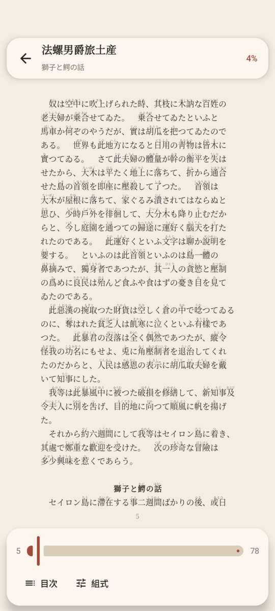

# 縦読み — Tateyomi

縦書きの組式で読むための Android 向けリフロー EPUB リーダーです。
WebView や既存の EPUB ビューアを使わず、Compose Canvas 上に日本語縦組の
レンダラーを実装しています。

| 本棚 | 縦書き（明朝・生成り） |
|---|---|
|  |  |

| 横書き（24字・行間1.7） | 縦書き（夜・明朝） |
|---|---|
|  |  |

| 目次（節アンカー対応） | 組式設定 |
|---|---|
|  |  |


## 主な機能

- **リフロー EPUB 2 / EPUB 3 の取り込み**（SAF。複数選択可）
  - OPF / spine / EPUB3 nav / EPUB2 NCX / 表紙 / 画像 / ルビ / 見出し / 強調
  - 固定レイアウトの画像だけの spine にも対応（1ページ画像として表示）
- **縦書き・横書きの組式レンダリング**
  - 字数（1行／1列の文字数）、行数（1ページの行数／列数）、行間、字下げ、余白、フォント
  - 文字サイズは字数・行数・行間から自動計算し、端末の表示領域に収まらない場合は自動縮小
  - 行間は文字サイズに対する行ピッチの倍率として維持
  - 縦書きのルビ、句読点の縦組字形（OpenType `vert`）、欧文の90度回転
  - ページ単位の送り（タップ／スワイプ）、ページスライダー
  - ヘッダー／フッターは常時表示
- **組式プリセット**
  - 文庫 / 単行本 / 大活字 / 横書き
  - 現在の設定を名前付きで保存・削除
  - 組方向の切り替え時は、縦横それぞれに適した字数・行数へ自動調整
- **ライブラリ**
  - 表紙付きグリッド、続きから読むカード、長押し削除
  - 表紙がない EPUB はタイトルから縦書き風の表紙を自動生成
- **読書進捗の保存**
  - 章インデックス + 章内位置（組式を変えても同じ場所へ復帰）
  - アプリ再起動後も復帰
- **読書統計**
  - 今日 / 累計の読書時間、連続読書日数、読了冊数、読んだ文字数
  - 直近7日間グラフ、本ごとの読書時間と進捗
- **紙面テーマ**：生成り / 白 / 夜
- **フォント**：明朝（serif） / ゴシック（sans-serif） / 等幅（monospace）

## 操作

| 場所 | 操作 |
|---|---|
| 本文の左端 / 右端 | ページ送り（縦書き：左が次、右が前／横書き：右が次、左が前） |
| 左右スワイプ | ページ送り（縦書きは右スワイプで次） |
| ヘッダー／フッター | 常時表示（表示切替なし） |
| 下部バー | 目次、組式設定、ページスライダー |
| 設定シート | 変更はシートを閉じたときに適用 |
| 本棚の本 | タップで開く／長押しで削除 |

## 開発環境

Nix flake の devshell に JDK 17、Gradle、Android SDK 35、build-tools 35 を
含めています。`local.properties` は不要です。

```bash
nix develop

gradle assembleDebug        # app/build/outputs/apk/debug/app-debug.apk
gradle testDebugUnitTest    # JVM ユニットテスト
gradle lintDebug
gradle assembleRelease      # 署名なし release APK（R8 有効）
```

`direnv` を使う場合は `.envrc` の `use flake` を許可してください。

### 実機・エミュレータへのインストール

```bash
adb install -r app/build/outputs/apk/debug/app-debug.apk
```

ビルド済みの R8 リリース APK はローカルの `dist/tateyomi-1.0.0-debugsigned.apk`
に生成しています（ローカルの debug keystore で署名したテスト用。ストア配布用
ではありません）。APK などのビルド成果物は Git 管理外です。
この APK に EPUB は同梱されていません。本棚の「EPUBを追加」から取り込んでください。

## アーキテクチャ

```
app/src/main/java/app/tateyomi/
├── data/
│   ├── EpubParser.kt       EPUB 2/3 のテキスト・ルビ・画像・目次抽出
│   ├── AppRepository.kt    取り込み、JSON 永続化、進捗・設定・統計
│   ├── CoverGenerator.kt   表紙の正規化とプレースホルダー生成
│   ├── Model.kt            書籍・章・ブロック・目次・進捗
│   ├── Settings.kt         組式設定とプリセット
│   └── Stats.kt            読書統計
├── reader/
│   ├── ReaderLayout.kt     字数×行数のグリッド組版、禁則処理、ページ割付
│   ├── ReaderTypefaces.kt  端末フォントのキャッシュ
│   └── ...
├── ui/
│   ├── MainViewModel.kt    画面状態、読書セッション、進捗保存
│   ├── AppRoot.kt          画面遷移、Snackbar、ライフサイクル
│   ├── library/            本棚
│   ├── reader/             Pager、Canvas 描画、目次・設定シート
│   ├── stats/              読書統計
│   └── theme/              Material 3 テーマ、紙面パレット
└── util/                  時間・文字数・連続読書日数の整形
```

- **組版エンジン**は Android API に依存しない純 Kotlin です。1文字=1セルを
  基本に、ASCII はまとめて回転描画し、ルビは基底文字に追従させます。
  禁則（行頭の句読点・閉じ括弧、行末の開き括弧、欧文単語の空白折り返し）を
  簡易実装しています。
- **行間**は `fontSize × lineSpacing` を行ピッチとして厳密に適用します。
  文字サイズは「字数（インライン方向）」「行数 × 行間（ブロック方向）」の
  両方が端末の表示領域に収まるよう自動縮小され、テキストブロックは
  ページ内で中央寄せになります。行数は指定どおりに保たれます。
- **進捗**は `chapterIndex` と `chapterFraction` で保存するため、字数・行数・
  組方向を変えても同じ章内位置へ戻れます。
- **目次**は EPUB の fragment（`#id`）をブロックへ対応付け、章頭ではなく
  実際の見出し位置へジャンプします。Gutenberg の目次に混ざるルビ読みを
  見出し本文で補正します。
- **設定**はシートを閉じたときに適用します。スライダー操作中にページ割付が
  再計算されてシートが揺れるのを避けるためです。

### 保存先

アプリ専用領域 `filesDir/tateyomi/` 以下です。

```
library.json                  本棚インデックス
settings.json                 組式設定・プリセット
stats.json                    読書統計
books/<uuid>/source.epub      取り込んだ EPUB 原本
books/<uuid>/content.json     抽出済み本文（章・ブロック・ルビ・アンカー）
books/<uuid>/cover.jpg        正規化した表紙
books/<uuid>/images/<hash>    本文画像
```

EPUB は取り込み時にアプリ領域へコピーします。元ファイルを移動・削除しても
読めます。本を削除すると上記ディレクトリと統計からも削除します。

## テスト

### JVM ユニットテスト

```bash
gradle testDebugUnitTest
```

- `ReaderLayoutTest`：字数・行数・禁則・ルビ分割・ページ/進捗の往復
- `ReaderMetricsTest`：行数・行間を保った自動縮小と行ピッチ
- `EpubParserTest`：合成 EPUB（ルビ、画像、名前空間付き OPF、固定レイアウト画像 spine）
- `FormattingTest`：時間・文字数・連続読書日数
- `EpubCollectionTest`：手元の EPUB コーパスを一括パース（環境変数があるときだけ実行）

```bash
TATEYOMI_EPUB_DIR=~/epub-collection gradle testDebugUnitTest --tests '*EpubCollectionTest*'
```

Project Gutenberg の日本語 EPUB 2/3、台湾の繁体字 EPUB、固定レイアウト画像
EPUB など、作業時点のコーパス 29 冊でパースを確認済みです（現在の手元
コーパスは 10 冊で、こちらも 10/10 パース成功。コーパスはリポジトリに含みません）。

### 計測用シード（任意）

エミュレータで UI を確認するための instrumentation テストがあります。
`app/src/androidTest/assets` のパブリックドメイン EPUB を本棚へ取り込みます。

```bash
gradle connectedDebugAndroidTest -Pandroid.testInstrumentationRunnerArguments.class=app.tateyomi.SeedLibraryTest
```

`connectedDebugAndroidTest` は終了後にアプリをアンインストールする場合が
あります。その場合は上記 APK を手動インストールし、`adb shell am instrument`
で `SeedLibraryTest` を実行するとデータが残ります。詳細は
`app/src/androidTest/assets/NOTICE.txt` を参照してください。

## EPUB 対応と制限

- 本文は **テキスト優先** で抽出します。出版社 CSS は使わず、見出し・段落・
  ルビ・強調・画像だけを保持します。
- 画像は1枚につき1ページの全画面表示です（本文への回り込みなし）。
- SVG 画像はスキップします。DRM 付き EPUB は読めません。
- 表や複雑な段組は直列化されます。
- 禁則処理は基本的な集合のみです。`<br>` や段落境界をまたぐ行頭句読点は
  完全には防げません。
- 行数や行間を大きくすると、端末の表示領域に収めるために文字サイズが
  自動的に小さくなります。
- 縦書きの欧文は回転描画のため、字詰めに余白が出ることがあります。
- Canvas 描画のため、現状は TalkBack による本文読み上げに対応していません。
- フォントは端末の serif / sans-serif / monospace を使用します。端末に
  日本語明朝体がない場合は代替フォントになります。
- 本文のないページ（表紙のみ等）は取り込み時に除外します。画像だけのページは
  固定レイアウト本のために残します。
- 読書文字数は「ページ送り1回あたりの平均文字数」からの概算です。

## クレジット / ライセンス

- アプリ本体のライセンスは現時点で未指定です。必要に応じて `LICENSE` を
  追加してください。
- `app/src/androidTest/assets` の EPUB は Project Gutenberg 由来の
  パブリックドメイン作品で、UI 検証用です。リリース APK には含まれません。
  出典と注意は `NOTICE.txt` に記載しています。
- スクリーンショットの本文は上記パブリックドメイン作品です。
